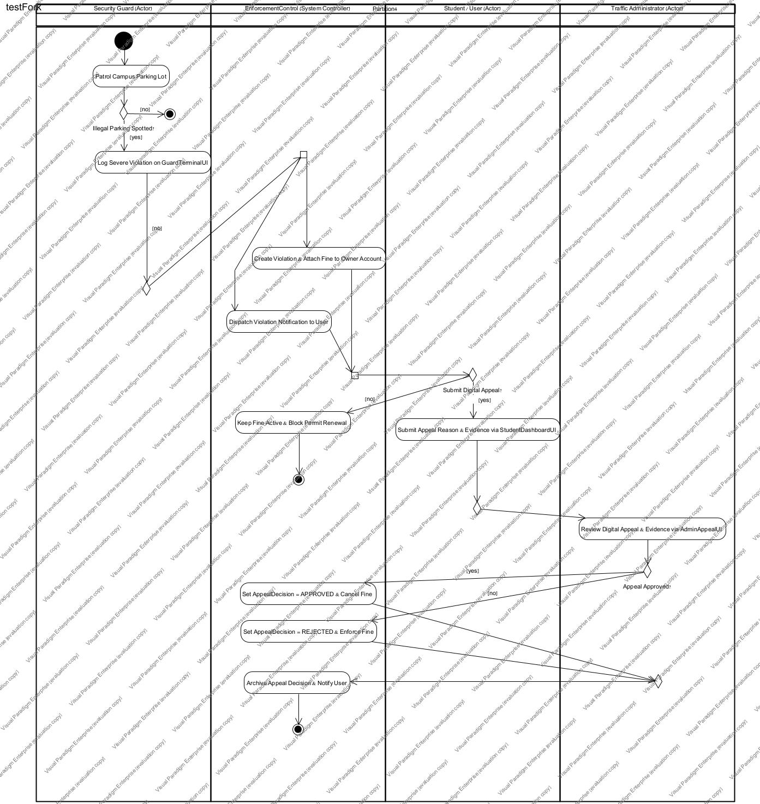
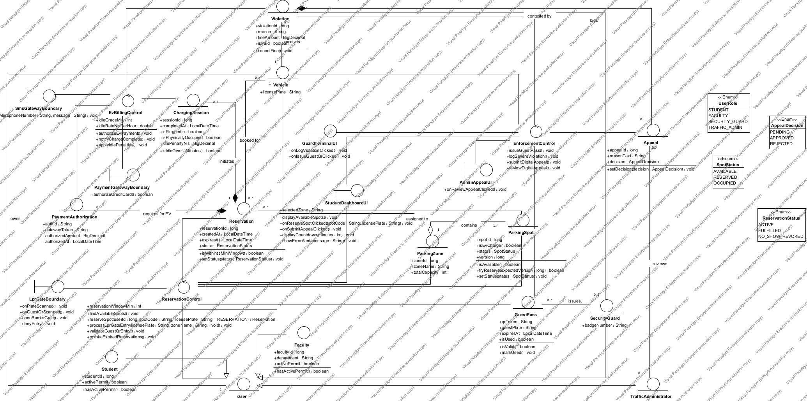
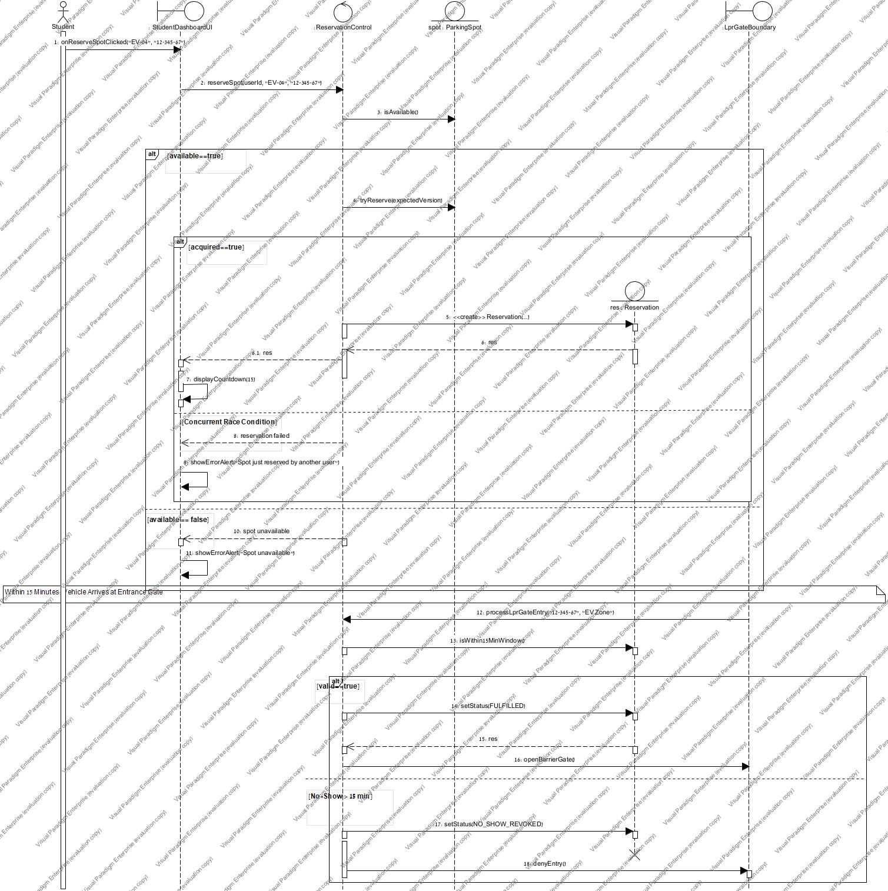
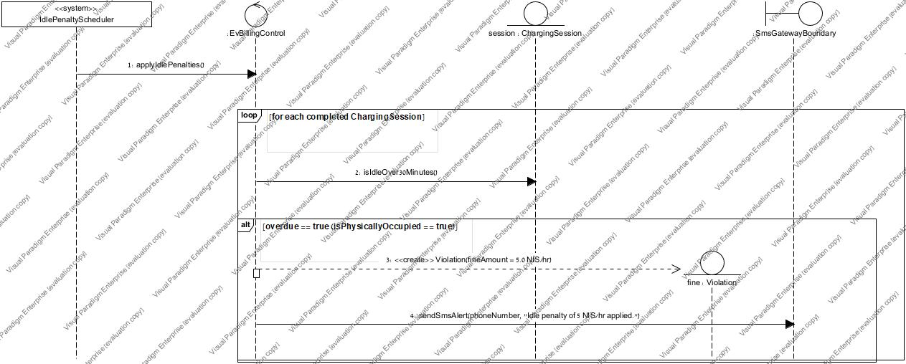

# System Architecture & Object-Oriented Design (`Ex4_SmartParking_Design`)

**Course:** 61756 Software Engineering Methods (Academic Year 2026-2027)
**Institution:** ORT Braude College of Engineering | Department of Software Engineering
**Domain:** Smart Campus Parking, LPR, and EV Network (Continued from Exercise 1)

---

## 1. Engineering Team Details

| Role | Full Name | Student ID | Braude Academic Email |
| :--- | :--- | :--- | :--- |
| **Student A (Role A)** | `[Noga feldman]` | `[212146740]` | `[Noga.feldman@e.braude.ac.il]` |
| **Student B (Role B)** | `[Selen daher]` | `[214228884]` | `[Selen.daher@e.braude.ac.il]` |

* **Group Number:** `G[XX]`
* **GitHub Repository URL:** `https://github.com/Noga-hub18/Ex4_SmartParking_Design.git`

---

## 2. Step 1: Business Process Modeling — Activity Diagram (`Visual Paradigm`)

* **PlantUML Source:** [`diagrams/activity_appeal.puml`](diagrams/activity_appeal.puml)
* **Visual Paradigm Model:** [`SystemModel_Ex4.vpp`](SystemModel_Ex4.vpp)
* **Partitions / Swimlanes:** Separates external **Actors** (`Security Guard`, `Student / User`, `Traffic Administrator`) from the internal **System Controller** (`EnforcementControl`), using `initial node`, `fork`/`join` (AND), `decision` (XOR) with explicit `[guards]`, `merge` (OR), and `activity final node`.



---

## 3. Step 2: Structural Modeling — ECB Class Diagram (`PlantUML` -> `Visual Paradigm`)

Following the **ECB (Entity-Control-Boundary)** architectural pattern:

| ECB Stereotype | Classes in System | Architectural Responsibility |
| :--- | :--- | :--- |
| **`<<boundary>>`** | `StudentDashboardUI`, `GuardTerminalUI`, `AdminAppealUI`, `LprGateBoundary`, `PaymentGatewayBoundary`, `SmsGatewayBoundary` | Interfaces with external Actors and external hardware/payment/SMS systems. Communicates ONLY with `<<control>>` classes. |
| **`<<control>>`** | `ReservationControl`, `EvBillingControl`, `EnforcementControl` | Multiple specialized controllers orchestrating business rules, timers, concurrency checks, and workflows. |
| **`<<entity>>`** | `User` (`Student`, `Faculty`, `SecurityGuard`, `TrafficAdministrator`), `GuestPass`, `Vehicle`, `ParkingZone`, `ParkingSpot`, `Reservation`, `PaymentAuthorization`, `ChargingSession`, `Violation`, `Appeal` + 4 UML `enum`s | Passive domain data classes storing persistent business state and domain helper methods. |

* **PlantUML Source:** [`diagrams/class_diagram_ecb.puml`](diagrams/class_diagram_ecb.puml)
* **Visual Paradigm Model:** [`SystemModel_Ex4.vpp`](SystemModel_Ex4.vpp)



---

## 4. Step 3: Behavioral Modeling — ECB Sequence Diagrams (`PlantUML` -> `Visual Paradigm`)

### 4.1 Sequence Diagram 1: Spot Reservation, LPR Gate Entry & No-Show Destruction
* **PlantUML Source:** [`diagrams/sequence_reservation_ecb.puml`](diagrams/sequence_reservation_ecb.puml)



### 4.2 Sequence Diagram 2: EV Charging 30-Minute Idle Penalty (`loop` & `<<create>>`)
* **PlantUML Source:** [`diagrams/sequence_idle_penalty_ecb.puml`](diagrams/sequence_idle_penalty_ecb.puml)



---

## 5. Independent AI Prompt & Architectural Design Critique (Part 4)

```text
[**1. Last-spot race:** The class diagram has the right ingredients—`version` and `tryReserve(expectedVersion)`—and 
the sequence diagram includes a competing-reservation failure branch. That can prevent double-booking **if** 
`tryReserve` atomically checks both the expected version and `AVAILABLE` status, reserves the spot, and increments the 
version. As drawn, that atomic contract is implicit: `isAvailable()` is a separate, potentially stale check, and the
sequence does not show where `expectedVersion` comes from or the boolean result returned by `tryReserve`. So the 
diagrams suggest the intended protection but don’t prove it.
To make it stronger, show `tryReserve(expectedVersion)` returning `acquired`, with the operation defined as an atomic
compare-and-set on status and version. Treat `isAvailable()` as a display/pre-check only. Also show that a `Reservation`
 is created and linked to the spot only after acquisition succeeds; optionally enforce one active reservation per spot in storage as a second safeguard.

**2. EV cable vs. physical occupancy:** The class diagram models `isPluggedIn` and `isPhysicallyOccupied` separately,
 which captures the needed distinction. But it does not define `isIdleOver30Minutes()` or show an EV penalty sequence, 
 so it remains unclear whether unplugging suppresses the penalty. For the minute-29 case, the rule should be explicit: 
 at the grace-period threshold, the penalty condition depends on the session being overdue **and** the bay still being 
 physically occupied—not on whether the cable is plugged in. The model also lacks an explicit state-update operation for
  unplugging/vacating and a direct link between the charging session and its resulting violation.

Add the predicate’s semantics and a sequence showing `isPluggedIn = false` while `isPhysicallyOccupied = true` at the
 threshold, then penalty creation; show the penalty stopping when physical occupancy becomes false. A state update/event
  for unplugging and vacating, plus a session-to-penalty association, would make that behavior easier to validate.]
```


* **Improvement 2 Applied (EV Physical Occupancy):** Separated `isPluggedIn` from `isPhysicallyOccupied` on `ChargingSession` so unplugging the cable at minute 29 without moving the car still triggers the 30-minute Charger Idle Penalty.

---

## 6. License
Distributed under the **ORT Braude College Academic License** (61756 Software Engineering Methods, 2026-2027).
